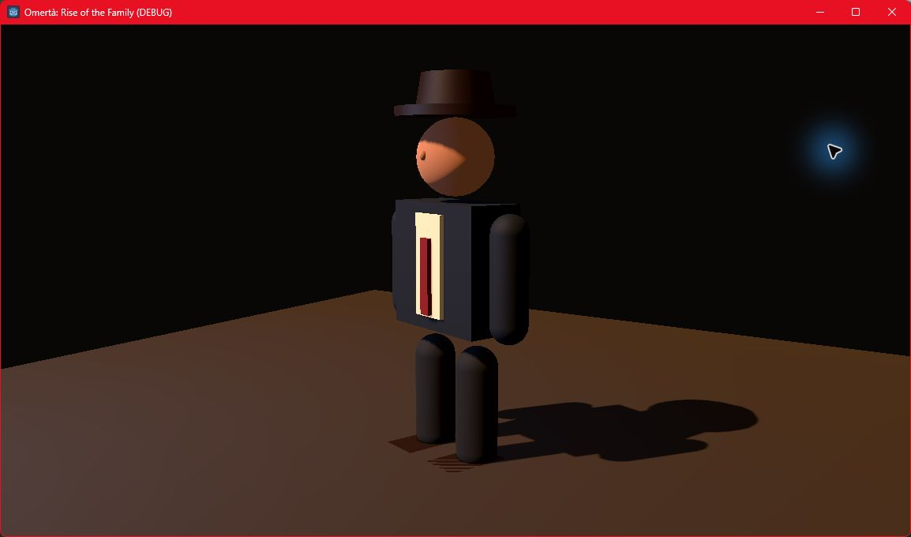

# Incremento posterior a la Etapa 6 — Humanoide provisional y animación

## Objetivo

La cápsula azul ya no representa al protagonista. `PrototypeHumanoid.tscn` construye una
silueta humana articulada con primitivas 3D: traje oscuro, camisa clara, corbata roja,
zapatos y fedora. El propósito no es arte definitivo sino validar escala, lectura
isométrica y futuras ubicaciones de armas antes de importar un personaje externo.

La colisión continúa perteneciendo al `CharacterBody3D` original. También se conservaron
las rutas `Visual/Weapon` y `Visual/BackWeapon`, por lo que combate, loadout, baúl y
persistencia no necesitan conocer la nueva presentación.

## Estados visuales

`HumanoidVisualController` traduce el estado real de `PlayerController` a una pose
procedural suavizada:

- `Idle`, caminar y correr, con zancada y oscilación vertical diferenciadas;
- crouch;
- ADS;
- cobertura alta o baja;
- vault.

Los brazos, piernas y torso interpolan hacia cada pose. Al conducir se mantiene el
comportamiento existente del jugador, que oculta su nodo visual completo. Esta capa es
intencionalmente compatible con una futura implementación basada en `AnimationTree`: los
estados de gameplay ya están separados de la malla que los representa.

## Escena de exhibición

`CharacterShowcase.tscn` ofrece luz cálida, relleno frío, piso neutro y una cámara cercana
para revisar proporciones sin ejecutar todo el bloque urbano. Sólo en esta escena se
ocultan las armas para mostrar con claridad la silueta del personaje.

Captura del estado actual:

## Límites conocidos

- No existe todavía una malla skinned, `Skeleton3D` ni animación capturada/importada.
- Manos, rostro, abrigo y detalles de época siguen reducidos a primitivas.
- Las armas conservan sus anclajes graybox y deberán montarse en huesos de mano,
  pistolera y espalda.
- La entrada y salida de vehículos todavía oculta/muestra el personaje; no posee una
  animación corporal específica.

## Validación

- Compilación .NET sin errores ni advertencias.
- Carga headless de `CharacterShowcase.tscn` con Godot 4.7.2 .NET.
- Smoke completo del slice: 423 nodos estables durante 120 frames.
- 58 pruebas de reglas de dominio aprobadas después del cambio.

## Próximo incremento recomendado

Incorporar un personaje humano riggeado y licenciado, importarlo como `Skeleton3D` y
retargetear primero idle, caminar, correr, crouch y ADS. Después se agregan cobertura,
vault y entrada/salida de vehículo. Conviene conservar `HumanoidAnimationState` como
contrato y reemplazar únicamente la salida procedural por parámetros de `AnimationTree`.
